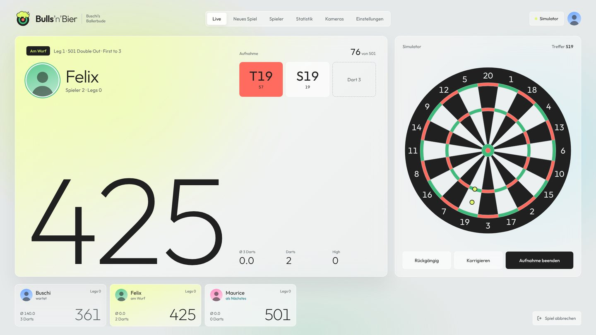
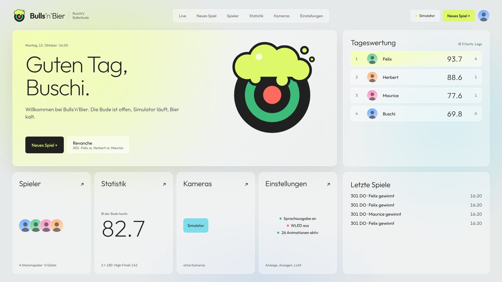
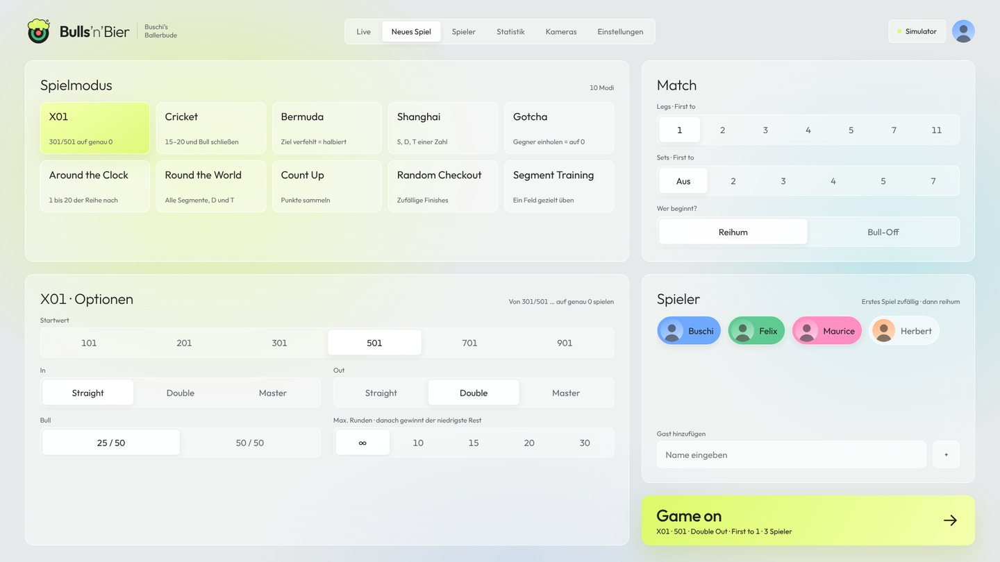
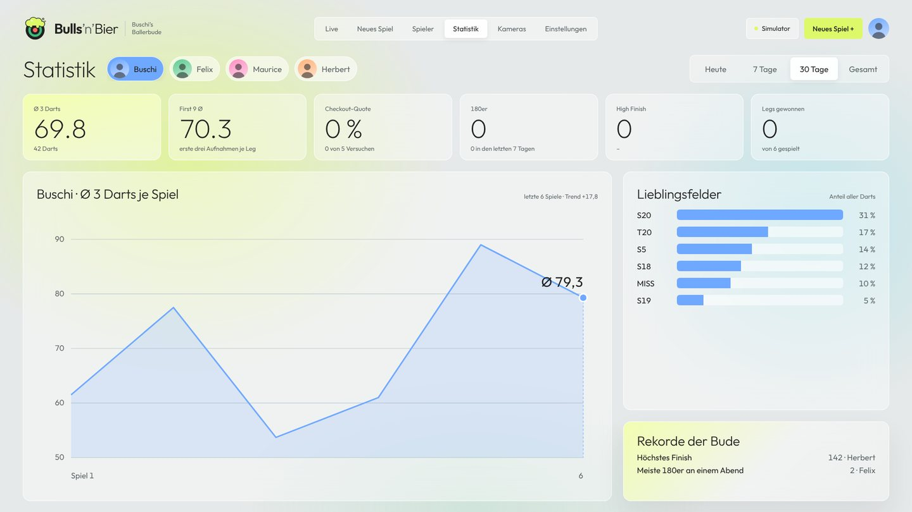
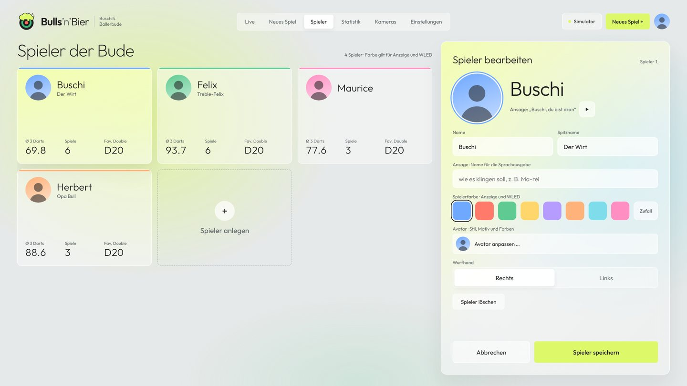
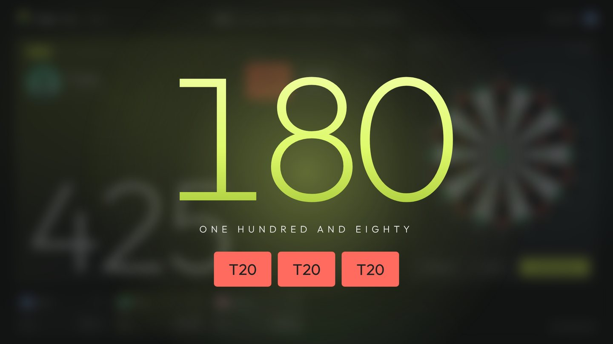
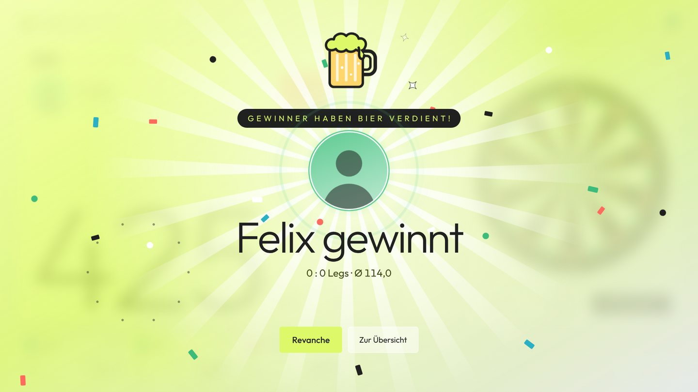
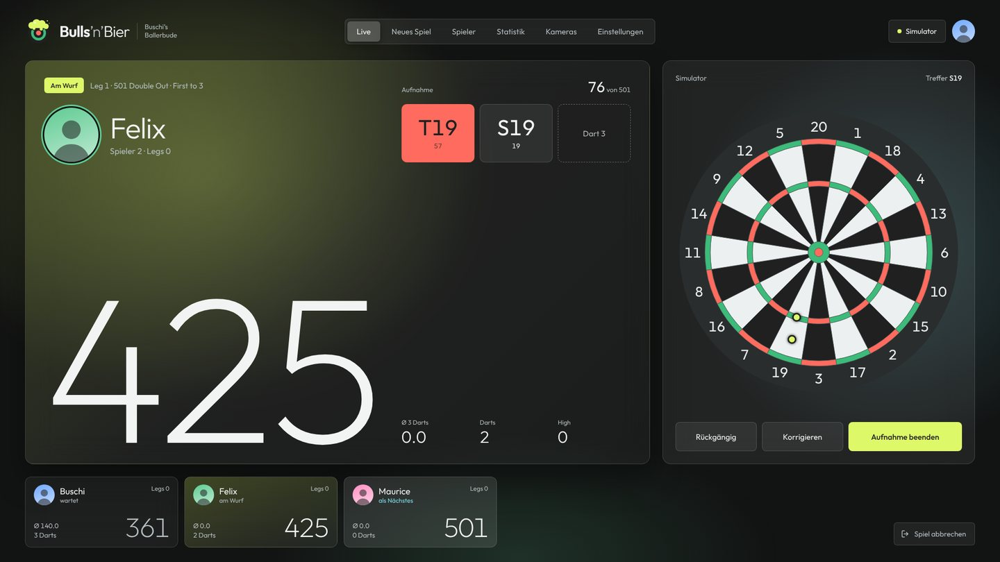
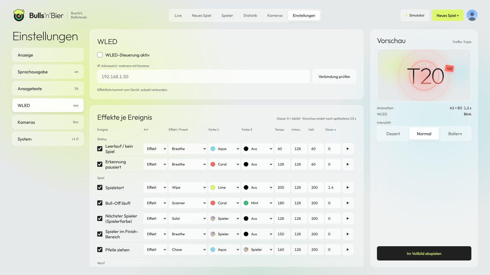
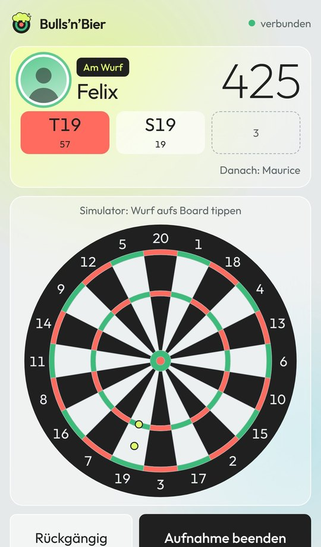

# Bulls’n’Bier

Die Darts-App für Buschi’s Ballerbude: kamerabasierte Dart-Erkennung (Autodarts-Nachbau) – läuft unter **Linux und Windows**, jeweils live mit Kameras oder als **Simulator** zum Testen. Oberfläche nach Styleguide v01 (Bühne 1920 × 1080, skaliert auf jeden Bildschirm).



| | |
|---|---|
|  |  |
| **Start** – Begrüßung, Tageswertung, letzte Spiele | **Neues Spiel** – 10 Modi, Optionen, Spieler antippen |
|  |  |
| **Statistik** – Ø 3 Darts, Checkout-Quote, Lieblingsfelder | **Spieler** – Farbe, Ansage-Name, DiceBear-Avatare |
|  |  |
| **Effekte** – 180, High Finish, Bull … | **Sieg** – Gewinner haben Bier verdient! |
|  |  |
| **Nachtmodus** | **WLED** – Lichteffekt je Ereignis |



**Handy als Fernbedienung:** `/remote` (öffnet sich am Handy automatisch) – Werfer, Board zum Eintragen, Korrektur per Tabelle.

**Schnellstart:** [Linux-Anleitung](docs/LINUX.md) · Windows: `BullsnBier-Setup-x.y.z.exe` unter [Releases](https://github.com/felixbro/BullsnBier/releases) · [Kurzanleitung (PDF)](docs/Kurzanleitung.pdf)

<br clear="right">

## Systemanforderungen

| | Minimum | Empfohlen |
|---|---|---|
| Python | 3.10 | 3.12 |
| CPU (live, 3 Kameras 720p) | 4 Kerne, z. B. Raspberry Pi 5 | x86 Mini-PC, Intel N100 oder besser |
| RAM | 2 GB | 4 GB |
| Kameras | 3× USB-UVC mit **MJPG** | Autodarts-Kameras, je an eigenem USB-Port |
| Licht | – | LED-Ring, konstantes Licht |
| Simulator | jeder PC mit Python 3.10+ und Browser | |

Sprachausgabe: **Piper** (natürliche Offline-Stimmen, Linux + Windows). Häufige Ansagen (Felder, Punkte, Namen, Restwerte) werden im Hintergrund vorberechnet, damit es im Spiel sofort spricht. Fallback: Systemstimme des Browsers.

Avatare: **DiceBear HTTP-API** (`api.dicebear.com/9.x/<stil>/svg`), 20 Stile, Hintergrund- und Akzentfarbe nur aus der CI-Palette. Der Server lädt jedes Bild einmal und speichert es in `data/avatars/`. Ohne Netz bleibt die Silhouette.

## Linux

Ausführlich mit fertigem Paket, Kalibrierung und Fehlersuche: **[docs/LINUX.md](docs/LINUX.md)**

```bash
git clone https://github.com/felixbro/BullsnBier.git && cd BullsnBier
./install.sh                 # venv, Stimmen, systemd-Dienst, Autodarts-Dienst aus
nano config.env              # CAMERAS=… (python run.py --list-cameras)
sudo systemctl restart dartcam
```

```bash
./start-sim.sh               # Simulator
./start.sh                   # live im Vordergrund (ohne Dienst)
journalctl -u dartcam -f     # Log
```

## Windows

```bat
git clone https://github.com/felixbro/BullsnBier.git
cd BullsnBier
install-windows.bat          :: venv + Stimmen + Kamera-Liste
start-sim.bat                :: Simulator
start.bat                    :: live mit Kameras (CAMERAS=0,1,2 in config.env)
autostart-windows.bat        :: optional: Start bei Anmeldung
```

Python **3.12 (64-bit)** von python.org mit Haken „Add to PATH“ (3.10–3.13 gehen auch; für ganz neue Versionen fehlen oft noch Pakete wie onnxruntime). `install-windows.bat` sucht die passende Version selbst und lässt sich jederzeit erneut starten. Zugriff von Handy/Tablet: Windows-Firewall für Port 8090 freigeben.

## Fertige App (ohne Python)

Unter **GitHub → Actions → Build → Run workflow** (oder per Tag `git tag v1.0.0 && git push --tags`, dann als Release) entstehen:

| Datei | Nutzung |
|---|---|
| `BullsnBier-Setup-x.y.z.exe` | Windows-Installer: Startmenü + Desktop (Live und Simulator), optional Autostart, Firewall-Freigabe, Stimme laden |
| `BullsnBier-linux-x64.tar.gz` | entpacken, `./BullsnBier/install.sh` (Startmenü) oder `./BullsnBier/install.sh --service` (Autostart-Dienst) |

```bash
tar xzf BullsnBier-linux-x64.tar.gz && cd BullsnBier
./BullsnBier --sim --open            # Simulator
./BullsnBier --get-voice             # natürliche Stimmen laden
```

Daten liegen bei der fertigen App unter `%LOCALAPPDATA%\BullsnBier` bzw. `~/.local/share/bullsnbier` (dort auch `config.env`).
Lokal bauen: `pip install pyinstaller && python packaging/build.py`.

## Docker (Simulator-Demo)

Für eine Demo über das Internet läuft nur der Simulator, Kameras gibt es im Container keine.

```bash
git clone https://github.com/felixbro/BullsnBier.git && cd BullsnBier
ACCESS_KEY=meinschluessel docker compose up -d --build
```

→ `http://server:8080/?key=meinschluessel` (einmal öffnen, danach merkt sich der Browser den Schlüssel). Ohne `ACCESS_KEY` ist die App offen.
Daten liegen in `./data-docker`. Für HTTPS einen Reverse-Proxy davorschalten (Pangolin, Caddy, Traefik, Cloudflare Tunnel); WebSockets müssen durchgereicht werden.

## Handy als Fernbedienung

`http://<pc>:8090/remote` zeigt den aktuellen Werfer und das Board. Ein Tipp aufs Board trägt den Wurf ein, ein Tipp auf einen Dart und dann aufs Feld korrigiert ihn. Handys landen automatisch dort. Die volle Ansicht bekommst du mit `/?desktop=1`, zurück zur Fernbedienung mit `/?desktop=0`.

## Bedienung

→ `http://<rechner>:8090`

1. **Kameras** → je Kamera Punkte 20/6/3/11 auf die Außenkante des Double-Rings setzen → Speichern
2. Board leer → **Referenz neu**
3. **Statistik** → Spieler anlegen (optional Aussprache) → **Neu** → Game on

| Aktion | |
|---|---|
| Simulator-Wurf | aufs Board klicken |
| Korrektur | Dart oben antippen → aufs Board tippen |
| Pfeile gezogen | `Enter` |
| Rückgängig | `Backspace` |

## Spiele

X01 · Cricket (Standard / Cut Throat / No Score, Tactics) · Bermuda · Shanghai · Gotcha · Around the Clock · Round the World · Count Up · Random Checkout · Segment Training
– Legs + Sets, Max. Runden, Bull 25/50 oder 50/50, Start: Reihum (erstes Spiel einer Runde zufällig, danach beginnt pro Spiel und pro Leg der Nächste, Reihenfolge bleibt) oder Bull-Off

## Einstellungen

| Bereich | |
|---|---|
| Anzeige | Vorwürfe ausblenden, Hell/Nacht, Gastgeber, Animationen je Ereignis + Vorschau, Intensität Dezent/Normal/Ballern |
| Sprachausgabe | DE/EN, Piper- oder Systemstimme, Tempo/Lautstärke, jede Ansage an/aus |
| Ansagetexte | alle Texte editierbar: `{name}` `{score}` `{points}` `{n}` `{dart}` `{target}` |
| WLED | IP(s), je Ereignis Effekt/Preset (Liste vom Gerät, nach Namen sortiert), Farben (auch Spielerfarbe), Tempo, Dauer, Test (endet nach max. 10 s) |

```bash
python run.py --get-voice                       # Standard-Stimmen laden
python run.py --get-voice de_DE-kerstin-low     # weitere Stimme
```

## WLED-Ereignisse

Leerlauf · Spielstart · Bull-Off · Nächster Spieler · Finish-Bereich · Pfeile ziehen · Single/Double/Triple/Bull/Miss · 100+/140+/180 · unter 20 · Überworfen · Halbiert · Gotcha · Shanghai · Finish 100+ · Leg · Winner · Nicht erkannt · Kalibrierung ungenau · Kamera fehlt · Pausiert

## config.env

| Variable | Standard | |
|---|---|---|
| `CAMERAS` | Win `0,1,2` · Linux `/dev/video0,2,4` | Kameraquellen |
| `CAM_W` / `CAM_H` | 1280 / 720 | Auflösung |
| `PORT` | 8090 | |
| `DIFF_THR` | 28 | Helligkeitsschwelle |
| `DART_MIN` / `DART_MAX` | 250 / 40000 | Fläche Pfeil / ab hier Hand |
| `TAKEOUT_PX` | 3 × DART_MIN | Restabweichung zum leeren Board = Pfeile gezogen |
| `STABLE_FRAMES` | 6 | Ruhe-Frames bis Auswertung |
| `FUSE_MM` | 12 | Ausreißer zwischen Kameras |
| `CAL_WARN_MM` | 20 | Abweichung zwischen Kameras → Warnung „Kalibrierung ungenau“ |

Simulator-Daten liegen getrennt in `data-sim/`, Live-Daten in `data/`, Stimmen in `voices/`.
